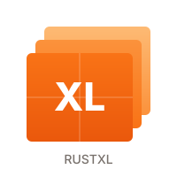

# xl

<div align="center">
  
</div>

<div align="center">
  <h3>A fast, terminal-based spreadsheet application written in Rust.</h3>
</div>

<div align="center">
  
  
</div>

## Features

- **Vim-style navigation** - Intuitive keyboard-driven interface with modal editing
- **Formula support** - Excel-compatible formulas including SUM, AVG, MIN, MAX, IF, VLOOKUP, and more
- **Multiple file formats** - Open and save CSV, TSV, and Excel (.xlsx, .xls) files
- **Piped input** - Load data directly from stdin (e.g., `ls -la | xl`)
- **Cell styling** - Colors, alignment, bold text, and data type formatting
- **Find & replace** - Search through cells with highlighted matches
- **Clipboard support** - Copy, cut, and paste with system clipboard integration
- **Dark/Light mode** - Toggle between color themes with persistent settings
- **Row/Column operations** - Select, insert, and delete entire rows or columns
- **Shell integration** - Run commands from `=SHELL("command")` cells with a preview before applying output

## Installation

### Quick Install (Recommended)

We provide installation scripts that automatically detect your OS and architecture, then download and install the appropriate pre-built binary.

#### Linux/macOS

```bash
curl -fsSL http://rustxl.com/install.sh | bash
```

The script will:
- Detect your OS (Linux/macOS) and architecture (x86_64/aarch64)
- Download the appropriate release
- Install `xl` to `/usr/local/bin` or `~/.local/bin`
- Provide instructions if PATH configuration is needed

#### Windows

**PowerShell (Recommended):**
```powershell
irm http://rustxl.com/install.ps1 | iex
```

**Note:** If you encounter an execution policy error, run:
```powershell
Set-ExecutionPolicy -ExecutionPolicy RemoteSigned -Scope CurrentUser
```

**Command Prompt (Alternative):**
```cmd
curl -fsSL http://rustxl.com/install.bat -o install.bat && install.bat
```

The Windows scripts will:
- Download the Windows x86_64 release
- Install `xl.exe` to `%LOCALAPPDATA%\rustxl\bin`
- Automatically add it to your PATH

**Note:** You may need to restart your terminal after installation for PATH changes to take effect.

### Manual Installation

Download the appropriate pre-built binary from [GitHub Releases](https://github.com/only-using-ai/rustxl/releases):

- **Linux**: `xl-linux-x86_64.tar.gz` or `xl-linux-aarch64.tar.gz`
- **macOS**: `xl-macos-x86_64.tar.gz` or `xl-macos-arm64.tar.gz`
- **Windows**: `xl-windows-x86_64.zip`

Extract the archive and move the binary (`xl` or `xl.exe`) to a directory in your PATH.

### From source

```bash
git clone https://github.com/only-using-ai/rustxl.git
cd rustxl
cargo build --release
```

The binary will be available at `target/release/xl`.

### Dependencies

- Rust 2024 edition
- Terminal with ANSI color support

## Usage

### Basic usage

```bash
# Start with an empty spreadsheet
xl

# Open a file
xl -f data.csv
xl --file spreadsheet.xlsx

# Pipe data from another command
ls -la | xl
cat data.csv | xl --stdin-format csv
cat data.tsv | xl --stdin-format tsv
```

Piped input defaults to `--stdin-format auto`. It looks for two or more fields
with a consistent width across records and prefers TSV if both delimiters fit.
Otherwise it splits command output on whitespace. Select `csv` or `tsv` for
single-column or ambiguous data, or to receive the same parse errors as opening
a file. Select `whitespace` to split command output that resembles CSV or TSV.
`--file` opens a file directly and skips stdin.

### Keyboard Shortcuts

#### Normal Mode (READY)

| Key | Action |
|-----|--------|
| `Arrow keys` | Navigate cells |
| `Shift+Arrow` | Select range |
| `Enter` | Edit cell |
| `Delete/Backspace` | Clear cell(s) |
| `Tab` | Enter Visual mode |
| `f` | Find mode |
| `o` | Open file |
| `s` | Save file |
| `t` | Format as table |
| `Shift+R` | Row select mode |
| `Shift+C` | Column select mode |
| `:` | Command mode (vim-style) |
| `:run` then `Enter` | Preview the selected SHELL cell |
| `Ctrl/Cmd+C` | Copy |
| `Ctrl/Cmd+X` | Cut |
| `Ctrl/Cmd+V` | Paste |
| `Alt+Arrow` | Jump to data boundary |
| `q` | Quit |

Paste uses the current system clipboard. RustXL preserves cell styles when it
recognizes its own copied data. With desktop clipboard access, Cut moves cells
only when RustXL can verify that its clipboard entry is still current. The
macOS and Windows adapters support that check. The Linux adapter falls back
to copy when it cannot verify ownership. Cut also works within RustXL when
there is no desktop clipboard connection.

#### Edit Mode

| Key | Action |
|-----|--------|
| `Enter` | Confirm and move down |
| `Arrow keys` | Confirm and move |
| `Tab` | Confirm and move right |
| `Esc` | Cancel editing |

#### Visual Mode

| Key | Action |
|-----|--------|
| `f` | Text color |
| `b` | Background color |
| `a` | Text alignment |
| `v` | Vertical alignment |
| `w` | Column width |
| `h` | Row height |
| `s` | Font size (bold) |
| `t` | Data type |
| `c` | Clear formatting |
| `m` | Toggle dark/light mode |
| `Esc` | Exit Visual mode |

#### Row/Column Select Mode

| Key | Action |
|-----|--------|
| `Arrow keys` | Extend selection |
| `d` | Delete selected rows/columns |
| `i` | Insert rows/columns |
| `Esc` | Exit selection mode |

### Formulas

Start any cell with `=` to enter a formula. Formulas are case-insensitive.

Inserting or deleting rows or columns updates references in surviving formulas. Ranges expand around insertions inside them and shrink when part of a range is deleted. A deleted reference shows `#REF!` if its cell or entire range is gone. Circular references show `#CYCLE!`.

#### Supported Functions

**Math & Statistics:**
- `SUM(range)` - Sum of values
- `AVG(range)` - Average of values
- `MIN(range)` - Minimum value
- `MAX(range)` - Maximum value
- `COUNT(range)` - Count of numeric values
- `COUNTA(range)` - Count of non-empty cells
- `ROUND(value, decimals)` - Round to decimal places
- `CORREL(range1, range2)` - Correlation coefficient for corresponding positions where both ranges contain a number

**Conditional:**
- `IF(condition, true_value, false_value)` - Conditional logic
- `COUNTIF(range, criteria)` - Count cells matching criteria
- `SUMIF(range, criteria, [sum_range])` - Sum cells matching criteria
- `AVERAGEIF(range, criteria, [avg_range])` - Average cells matching criteria

**Text:**
- `CONCATENATE(text1, text2, ...)` or `CONCAT(...)` - Join text
- `LEFT(text, num_chars)` - Left substring
- `RIGHT(text, num_chars)` - Right substring
- `MID(text, start, num_chars)` - Middle substring
- `LEN(text)` - Text length

**Lookup:**
- `VLOOKUP(value, range, col_index, [range_lookup])` - Vertical lookup. Use `FALSE` or `0` for an exact match. Use `TRUE`, a nonzero number, or omit the mode for an approximate match on sorted numeric keys.

**Special:**
- `SHELL("command")` - Store a shell command in a cell. Select it and enter `:run` to preview the command. Use the arrow keys to scroll and press `r` to run it. Review the destination range and overwrite count, then press `a` to replace the formula and apply the output. `Esc` closes either preview.

#### Formula Examples

```
=SUM(A1:A10)
=AVG(B1:B5, C1:C5)
=IF(A1>100, "High", "Low")
=VLOOKUP("Apple", A1:C10, 3)
=SHELL("date +%Y-%m-%d")
```

### Command Mode

Press `:` to enter command mode (vim-style):

- `:q` or `:quit` - Quit the application
- `:A1` - Jump to cell A1
- `:B23` - Jump to cell B23

### Data Types

In Visual mode, press `t` to set data type formatting:

| Key | Type | Format |
|-----|------|--------|
| `1` | Text | As-is |
| `2` | Number | Numeric formatting |
| `3` | Currency | `$X.XX` |
| `4` | Percentage | `X.X%` |
| `5` | Date | Date format |
| `6` | Time | Time format |
| `0` | Default | Auto-detect |

## File Formats

### Supported for Opening
- CSV (comma-separated)
- TSV (tab-separated)
- Excel (.xlsx, .xls)

### Supported for Saving
- CSV
- TSV

## Configuration

Settings are automatically saved to your system's config directory:
- macOS: `~/Library/Application Support/xl/settings.json`
- Linux: `~/.config/xl/settings.json`
- Windows: `%APPDATA%\xl\settings.json`

Currently persisted settings:
- Dark/Light mode preference

## Development

```bash
# Run in development
cargo run

# Run tests
cargo test

# Run with a file
cargo run -- -f example.csv
```

## Architecture

```
src/
├── main.rs        # Entry point, CLI handling
├── spreadsheet.rs # Core data structure and operations
├── formula.rs     # Formula parsing and evaluation
├── input.rs       # Keyboard input handling
├── ui.rs          # Terminal UI rendering
├── save.rs        # File I/O operations
├── style.rs       # Cell styling
├── types.rs       # Type definitions
├── settings.rs    # User settings persistence
└── constants.rs   # Configuration constants
```

## Contributing

Contributions are welcome! Please feel free to submit a Pull Request.

## License

This project is open source. See the LICENSE file for details.

## Acknowledgments

Built with:
- [ratatui](https://github.com/ratatui-org/ratatui) - Terminal UI framework
- [crossterm](https://github.com/crossterm-rs/crossterm) - Cross-platform terminal manipulation
- [calamine](https://github.com/tafia/calamine) - Excel file reading
- [arboard](https://github.com/1Password/arboard) - Cross-platform clipboard
